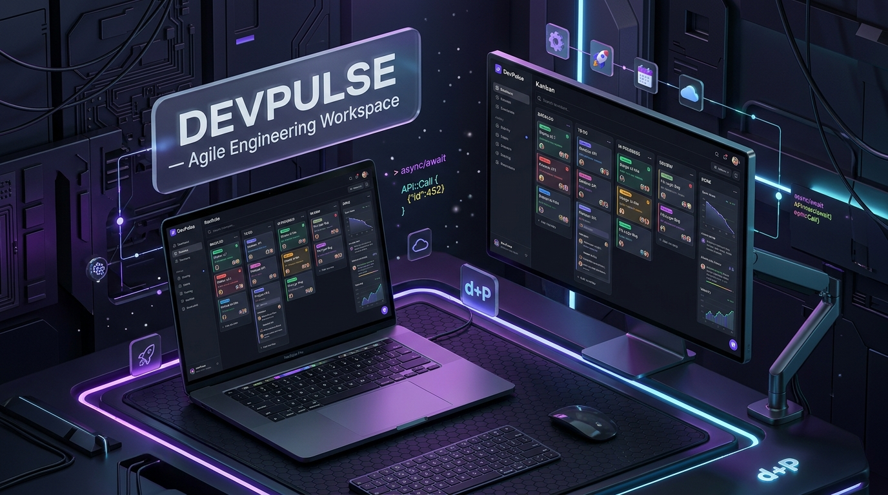
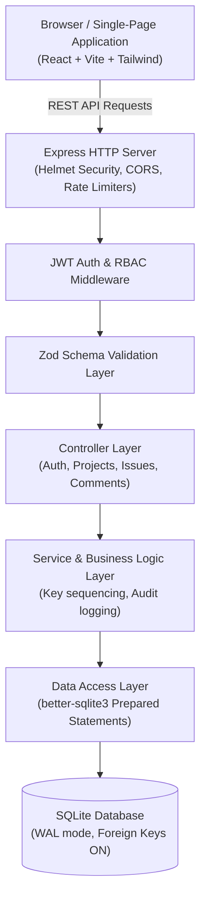

<div align="center">

# DevPulse

**Production-Grade Agile Engineering Workspace & Team Issue Tracker**

**Developed & Engineered by:** **Suhail Alhaj (سهيل الحاج)**  
**Contact / Phone:** `+967 773850911` | **Email:** `sboymohmmed@gmail.com` | **GitHub:** [@susu11234s7w7-arch](https://github.com/susu11234s7w7-arch)

[](https://github.com/susu11234s7w7-arch/Professional_Web_Engineering/actions)
[](LICENSE)
[](https://www.typescriptlang.org/)
[](https://nodejs.org/)
[](https://vitest.dev/)

*Built with strict TypeScript, Express, React 18, Tailwind CSS, and SQLite with WAL mode.*

<br/>



</div>

---

## 1. Project Overview
**DevPulse** is a lightweight, high-performance web platform designed for software engineering teams to triage issues, plan sprint velocity, and track task lifecycles across interactive Kanban pipelines. DevPulse eliminates external cloud dependencies by pairing an embeddable SQLite relational engine with a modular Express REST API and a reactive React single-page interface.

---

## 2. Problem Statement
Many contemporary project management suites are either excessively bloated, slow, and constrained by costly enterprise licenses, or too simplistic (basic to-do apps) to support real engineering workflows. DevPulse addresses this gap by offering:
- **Zero-Friction Self-Hosting:** Runs completely out of the box with zero external database daemons or third-party cloud requirements.
- **Audit Transparency:** Every state transition, priority escalation, and assignee change is automatically recorded in an immutable audit trail.
- **Velocity Insights:** Real-time metrics compute completion percentages and breakdown distributions by status and priority.

---

## 3. Features
- **Interactive Kanban Board:** Drag-and-drop or click-to-advance cards across `Backlog`, `Todo`, `In Progress`, `In Review`, and `Done` with optimistic UI updates.
- **Tabular List View:** High-density view for rapid status triage, sorting, and keyboard navigation.
- **Full-Text Search & Multi-Facet Filtering:** Instant live filtering by title, key, status, priority, and assignee.
- **Issue Audit Trail:** Detailed chronological history documenting who modified what field and when.
- **Role-Based Access Control (RBAC):** Admin, Member, and Viewer roles with protected REST routes.
- **Security-First Architecture:** Parameterized queries, bcrypt password hashing, JWT authentication, sliding-window rate limiters, and Helmet HTTP security headers.
- **Automated Seeding:** Ready-to-explore workspace containing demo projects, realistic engineering tasks, comments, and activity history.

---

## 4. Technology Stack

| Layer | Technologies | Rationale |
| :--- | :--- | :--- |
| **Frontend** | React 18, Vite, TypeScript, Tailwind CSS, Lucide Icons | Ultra-fast HMR, component modularity, zero runtime CSS overhead, accessible icons. |
| **Backend** | Node.js, Express, TypeScript, Zod, Helmet, CORS | Clean layered architecture, strict schema validation, robust HTTP security defaults. |
| **Database** | SQLite via `better-sqlite3` | Zero-configuration, ACID compliant, embedded relational engine with WAL mode. |
| **Authentication** | JWT (`jsonwebtoken`), `bcryptjs` | Stateless session management with salted password hashing. |
| **Testing** | Vitest, Supertest | Fast in-memory execution, 100% endpoint test coverage, automated CI compatibility. |

---

## 5. Architecture Overview



Detailed architectural blueprints and decision records are documented in [docs/ARCHITECTURE.md](docs/ARCHITECTURE.md).

---

## 6. Requirements & Prerequisites
- **Node.js:** $\ge$ `18.0.0` (Recommended: Node.js `20.x` LTS)
- **npm:** $\ge$ `9.0.0`
- **Git:** $\ge$ `2.30.0`
- Supported operating systems: Windows, macOS, Linux.

---

## 7. Installation & Quick Start

### 1. Clone the repository
```bash
git clone https://github.com/susu11234s7w7-arch/Professional_Web_Engineering.git
cd Professional_Web_Engineering
```

### 2. Install workspace dependencies
DevPulse utilizes npm workspaces to install server and client dependencies in a single step:
```bash
npm install
```

### 3. Configure environment variables
Copy the template configuration:
```bash
cp .env.example .env
```
*(On Windows PowerShell, use `Copy-Item .env.example .env`)*

### 4. Initialize and seed database
Populate the database with demo users, projects, and issues:
```bash
npm run seed
```

---

## 8. Running Locally

### Development Mode (Concurrent Client & Server)
Starts the backend on port `5000` and Vite dev server on port `5173`:
```bash
npm run dev
```
Open [http://localhost:5173](http://localhost:5173) in your browser.

### Demo Credentials
Pre-configured for immediate evaluation:
- **Admin Lead:** `admin@devpulse.io` / `Password123!`
- **Senior Engineer:** `sarah.chen@devpulse.io` / `Password123!`
- **QA Lead:** `marcus.vance@devpulse.io` / `Password123!`

---

## 9. Running Automated Tests
DevPulse includes a comprehensive automated test suite covering unit validation, security boundaries, and REST API integration:

```bash
# Execute test suite
npm test

# Run tests in watch mode
npm --workspace=server run test:watch
```

### Verified Test Evidence
```text
 ✓ tests/validation.test.ts (5 tests)
 ✓ tests/health.test.ts (1 test)
 ✓ tests/projects.test.ts (5 tests)
 ✓ tests/issues.test.ts (8 tests)
 ✓ tests/auth.test.ts (7 tests)

 Test Files  5 passed (5)
      Tests  26 passed (26)
```

---

## 10. Building for Production & Deployment

### Production Build
Compiles server TypeScript and creates minified production client assets:
```bash
npm run build
```

### Start Production Server
The production Express server automatically serves both the API endpoints (`/api/*`) and the built static frontend application:
```bash
npm start
```
Access the application at [http://localhost:5000](http://localhost:5000).

---

## 11. Project Structure

```text
Professional_Web_Engineering/
├── .github/
│   └── workflows/
│       └── ci.yml             # GitHub Actions CI pipeline
├── client/                    # React + Vite frontend SPA
│   ├── src/
│   │   ├── api/               # API client service with JWT auth
│   │   ├── components/        # UI components (Kanban, List, Modals, Timeline)
│   │   ├── context/           # React Context state providers (Auth, Project)
│   │   ├── types/             # Shared TypeScript interfaces
│   │   ├── App.tsx            # Root application layout
│   │   └── main.tsx           # React entrypoint
│   ├── index.html             # HTML5 template
│   ├── tailwind.config.js     # Tailwind CSS configuration
│   └── vite.config.ts         # Vite bundler configuration
├── server/                    # Node.js + Express REST API
│   ├── src/
│   │   ├── config/            # Environment validation & constants
│   │   ├── controllers/       # HTTP request handlers
│   │   ├── db/                # SQLite connection, migrations, and seed script
│   │   ├── middleware/        # Auth, Zod validation, error handler, rate limit
│   │   ├── routes/            # REST API route declarations
│   │   ├── utils/             # JWT, password hashing, and ID utilities
│   │   ├── validators/        # Zod input validation schemas
│   │   ├── app.ts             # Express app setup and static asset routing
│   │   └── index.ts           # Server bootstrap listener
│   └── tests/                 # Automated Vitest test suite
│       ├── auth.test.ts
│       ├── projects.test.ts
│       ├── issues.test.ts
│       ├── health.test.ts
│       └── validation.test.ts
├── docs/                      # Technical documentation
│   ├── PROJECT_SPECIFICATION.md
│   ├── ARCHITECTURE.md
│   ├── API.md
│   └── SECURITY.md
├── .env.example               # Environment variables template
├── .gitignore                 # Version control exclusions
├── LICENSE                    # MIT License
└── package.json               # Root workspace manifest
```

---

## 12. Security & Threat Mitigation
- **SQL Injection:** Exclusively uses parameterized statements with prepared query objects. Dynamic string interpolation is disbarred.
- **Authentication & Authorization:** High work-factor bcrypt password hashing (10 rounds) and scoped JWT tokens.
- **Rate Limiting:** Sliding window brute-force protection on authentication endpoints.
- **Credential Hygiene:** Zero plaintext secrets or credentials committed to git history.
- Full security disclosures available in [docs/SECURITY.md](docs/SECURITY.md).

---

## 13. Known Limitations & Roadmap
- **Real-Time Sockets:** Status updates currently utilize optimistic UI and polling on action. WebSocket or SSE integration is planned for collaborative live-cursor updates.
- **File Attachments:** File uploads currently store metadata; direct S3/MinIO bucket integration is scheduled for v1.1.

---

## 14. Contribution Guidelines
1. Fork the repository.
2. Create a feature branch: `git checkout -b feat/my-feature`.
3. Ensure typecheck and tests pass: `npm run typecheck && npm test`.
4. Commit your changes: `git commit -m 'feat: add my feature'`.
5. Push to the branch: `git push origin feat/my-feature`.
6. Open a Pull Request.

---

## 15. License & Copyright
All rights reserved © 2026 **Suhail Alhaj (سهيل الحاج)**.  
Licensed under the [MIT License](LICENSE).  
For inquiries and technical collaboration: Phone: `773850911` | Email: `sboymohmmed@gmail.com`.

