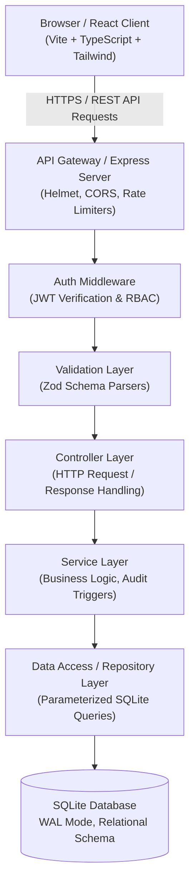
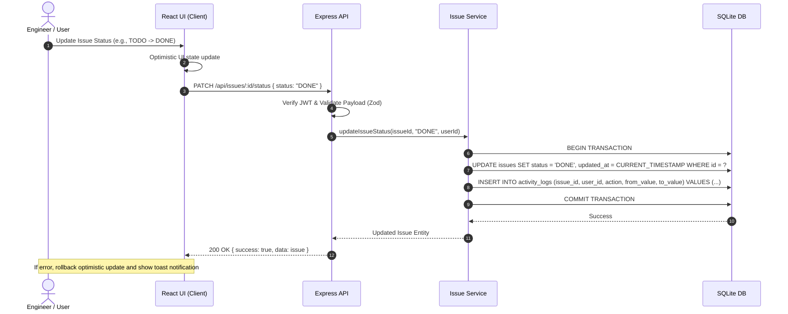

# DevPulse — Software Architecture Specification

## 1. Architectural Style & Overview
DevPulse is designed following a **Layered Modular Architecture** with clear separation of concerns. It is organized as a unified full-stack TypeScript workspace comprising a robust Node.js/Express REST backend and a reactive React/Vite single-page frontend.



## 2. Component Layers & Separation of Concerns

### 2.1 Backend Architecture (`/server`)
The backend is structured into five distinct layers:

1. **Config Layer (`src/config`):**
   - Validates environment variables (`PORT`, `JWT_SECRET`, `NODE_ENV`, `DATABASE_PATH`) on startup using `dotenv` and fallback defaults.
   - Database connection factory managing the SQLite instance, enabling foreign keys (`PRAGMA foreign_keys = ON`) and WAL mode (`PRAGMA journal_mode = WAL`).

2. **Middleware Layer (`src/middleware`):**
   - `authMiddleware`: Verifies Bearer JWT tokens and attaches authenticated user payload (`id`, `email`, `role`) to the Express Request.
   - `validate`: Higher-order middleware accepting Zod schemas to validate `req.body`, `req.query`, or `req.params`.
   - `errorHandler`: Global catch-all handler intercepting unhandled errors, formatting standard JSON responses (`{ success: false, error: { message, code, details } }`), and suppressing stack traces in production.
   - `rateLimiter`: Protects authentication endpoints against brute-force attacks.

3. **Controller Layer (`src/controllers`):**
   - Decoupled from HTTP framework details as much as possible.
   - Handles request inputs, calls the service layer, and maps service responses to appropriate HTTP status codes (`200 OK`, `201 Created`, `204 No Content`).

4. **Service Layer (`src/services`):**
   - Contains core business logic:
     - Issue number sequencing (`PROJECT_KEY-1`, `PROJECT_KEY-2`).
     - Activity log generation upon status transitions or assignment modifications.
     - Role-based authorization verification (e.g., ensuring a user is allowed to edit or delete a resource).

5. **Data Access Layer (`src/models` & `src/db`):**
   - Direct parameterized SQL execution via `better-sqlite3` / `sqlite3`.
   - Schema migration runner executing SQL migration files in sequence to maintain reproducible database states.

### 2.2 Frontend Architecture (`/client`)
The client uses React 18+ with Vite and TypeScript:

1. **API Client (`src/api`):**
   - Centralized Axios/fetch wrapper with automatic `Authorization: Bearer <token>` injection and response error normalization.

2. **State & Context (`src/context`):**
   - `AuthContext`: Tracks user authentication status, login/logout actions, and persists JWT tokens in `localStorage`.
   - `ProjectContext`: Holds active project state, Kanban column caches, filter criteria, and optimistic update handlers.

3. **Components & Layouts (`src/components`):**
   - **Kanban Board:** Column-based card pipeline with drag-and-drop or one-click status advancement.
   - **Issue Modal / Drawer:** Detailed view and edit forms with Markdown-enabled descriptions and comment streams.
   - **Activity Timeline:** Visual feed of changes made to the current project/issue.
   - **Metrics Card & Chart:** High-level project progress bar and priority counters.

## 3. Data Flow & Transaction Management


## 4. Error Handling Strategy
DevPulse enforces a canonical error representation for both API responses and client-side handling:

```json
{
  "success": false,
  "error": {
    "code": "VALIDATION_ERROR",
    "message": "Invalid issue status provided",
    "details": [
      {
        "field": "status",
        "message": "Expected 'BACKLOG' | 'TODO' | 'IN_PROGRESS' | 'IN_REVIEW' | 'DONE'"
      }
    ]
  }
}
```

Standard HTTP status mappings:
- `400 Bad Request`: Malformed JSON or invalid syntax.
- `401 Unauthorized`: Missing, expired, or invalid JWT token.
- `403 Forbidden`: Authenticated user lacks permission for the resource.
- `404 Not Found`: Target entity does not exist.
- `422 Unprocessable Entity`: Validation failure on input schema.
- `429 Too Many Requests`: Rate limit reached.
- `500 Internal Server Error`: Unhandled server-side exception (logged, with details obscured from client).

## 5. Security Architecture
1. **Password Security:** Salted hashes generated via `bcryptjs` with standard 10 salt rounds. Plaintext passwords never stored or logged.
2. **SQL Injection Defense:** All queries strictly utilize parameterized queries (`?` placeholders). String concatenation for SQL queries is prohibited.
3. **Cross-Site Scripting (XSS):** React automatically escapes JSX expressions. HTML injection is sanitized.
4. **Cross-Origin Resource Sharing (CORS):** Strict origin white-listing configured via environment variables.
5. **Security Headers:** `helmet` applies `X-Content-Type-Options`, `X-Frame-Options`, `Strict-Transport-Security`, and disabled `X-Powered-By`.

## 6. Database Schema Design
Entities:
- `users`: `id`, `email`, `password_hash`, `full_name`, `avatar_url`, `role`, `created_at`
- `projects`: `id`, `name`, `key` (unique), `description`, `owner_id`, `created_at`, `updated_at`
- `project_members`: `project_id`, `user_id`, `role`, `joined_at`
- `issues`: `id`, `project_id`, `issue_number`, `key` (`DEV-1`), `title`, `description`, `status`, `priority`, `type`, `assignee_id`, `reporter_id`, `due_date`, `created_at`, `updated_at`
- `comments`: `id`, `issue_id`, `user_id`, `content`, `created_at`, `updated_at`
- `activity_logs`: `id`, `issue_id`, `project_id`, `user_id`, `action`, `field_changed`, `old_value`, `new_value`, `created_at`

